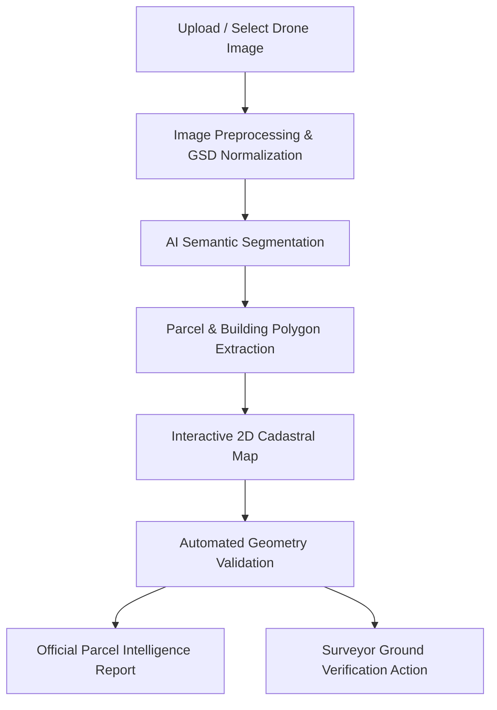

# UrbanParcel AI

### AI-Powered Urban Parcel Mapping and Cadastral Feature Extraction using Drone Imagery

[](https://www.sih.gov.in/)
[](https://www.sih.gov.in/)
[-green.svg)](https://dolr.gov.in/)
[]()
[](LICENSE)

---

## 1. Project Overview

**UrbanParcel AI** is an AI-assisted computer vision and cadastral mapping prototype designed to demonstrate automated extraction of urban parcels, building footprints, roadways, and open spaces from high-resolution drone orthomosaics. Developed for **Smart India Hackathon 2026**, the system showcases an end-to-end workflow from drone imagery ingestion to topological validation and certified parcel intelligence report generation.

> **IMPORTANT DISCLAIMER:**  
> - *This project is a prototype developed for Smart India Hackathon 2026.*  
> - *AI-generated or simulated results are intended for demonstration and decision-support purposes only.*  
> - *Prototype-generated parcel information must not be treated as an official cadastral or legal land record.*  
> - *Demo datasets are simulated unless explicitly stated otherwise.*  
> - *The system does NOT replace statutory cadastral authorities, revenue department surveys, or licensed ground surveys.*

---

## 2. SIH 2026 Problem Statement

- **Problem Statement ID:** SIH26012
- **Problem Statement:** AI-Based Automated Urban Parcel Mapping and Cadastral Feature Extraction System using Drone Imagery
- **Organization:** Ministry of Rural Development
- **Department:** Department of Land Resources (DoLR)
- **Category:** Software
- **Theme:** Smart Automation

---

## 3. Problem to Solve

Urban cadastral mapping and land records form the bedrock of property taxation, urban planning, citizen services, and municipal infrastructure. Traditional cadastral digitization relies heavily on manual photo-interpretation of drone surveys, physical Electronic Total Station (ETS) field verification, and manual GIS drafting.

In dense Indian urban clusters, this process is bottlenecked by:
- **Irregular parcel shapes:** Non-orthogonal plot boundaries and legacy sub-divisions.
- **Dense structural footprints:** Overlapping multi-storey buildings, chawls, and outhouses.
- **Encroachments & Setback Violations:** Structures extending into public rights-of-way.
- **Narrow access lanes:** Obscured lane alignments under tree canopy.
- **Massive drone survey volumes:** Terabytes of orthorectified imagery requiring weeks of manual vectorization.

---

## 4. Our Solution

UrbanParcel AI introduces an automated decision-support pipeline that accelerates cadastral digitization:
1. **Automated Feature Extraction:** Segments parcel boundaries, roof structures, access lanes, open courtyards, and vegetation masks from drone imagery.
2. **Topological Rule Engine:** Automatically checks for boundary polygon closure, coordinate validity, and flags overlapping parcels or setback intrusions.
3. **Interactive 2D GIS Map:** Allows surveyors to visually inspect parcel boundaries, click on properties, and evaluate structural density and road frontage.
4. **AI Surveyor Advisory:** Employs server-side Gemini AI (`gemini-3.8-flash`) to generate structured land-use rationales and actionable surveyor field remediation steps.
5. **Certified Parcel Intelligence Reports:** Generates professional, printable cadastral summaries with full feature inventories.

---

## 5. Key Features

- **Intuitive Light UI:** Clean, government-tech light theme with high contrast and readable typography.
- **Drone Imagery Ingestion:** Drag-and-drop file upload or instant selection of sample drone flights (Sector 4-B, Ward 12, Gram Kanthal).
- **Fast Animated Processing:** Realistic multi-stage pipeline: *Uploading → Preprocessing → Detecting Features → Extracting Boundaries → Generating Map*.
- **Interactive Multi-Layer Vector Overlay:** Toggleable color-coded layers:
  - 🟦 **Blue:** Parcel Boundaries
  - 🟥 **Red:** Building Footprints
  - 🟨 **Yellow:** Roads & Lanes
  - 🟩 **Green:** Open Areas & Setbacks
  - 🟪 **Purple:** Vegetation Canopy
  - 🟧 **Orange:** Flagged Encroachments / Overlaps
- **Interactive 2D Leaflet Map:** Pan, zoom, layer toggle, and click-to-inspect parcel envelopes.
- **Detailed Parcel Intelligence:** Area ($m^2$), perimeter ($m$), centroid coordinates, land use, building count, road connectivity, and model confidence scores.
- **Topological Geometry Validation:** Instant audit of polygon ring closure, coordinate bounds, duplicate detection, and overlap identification.
- **Printable Parcel Reports:** Automated report generator with clean print formatting for field surveyors.
- **Prominent SIH Demo Mode:** One-click guided walkthrough designed specifically for SIH judges.

---

## 6. How It Works & Workflow



---

## 7. System Architecture

```mermaid
graph LR
    subgraph Client ["Frontend (React 19 + TypeScript + Vite)"]
        UI[Government-Tech Dashboard]
        Map[Leaflet 2D GIS Engine]
        Overlay[SVG Vector Segmentation Layer]
    end

    subgraph Server ["Backend (Node.js + Express)"]
        API[REST API Endpoints]
        Val[Topology & Geometry Rule Engine]
        GenAI[Google GenAI SDK (gemini-3.8-flash)]
        Repo[Prisma Schema & In-Memory Cadastral Store]
    end

    UI -->|HTTP / JSON| API
    API --> Val
    API --> GenAI
    API --> Repo
    Map -->|GeoJSON Polygons| API
```

---

## 8. AI/ML Approach

- **Drone Orthomosaic Processing:** Designed for Ground Sampling Distance (GSD) inputs between $2.0\text{ cm/px}$ and $5.0\text{ cm/px}$.
- **Feature Segmentation Simulation:** Deterministic computer vision prototype outputting standard GeoJSON polygons for parcels, building footprints, and roadway centerlines.
- **AI Decision Support (Gemini):** Server-side integration using `@google/genai` and `gemini-3.8-flash`. Gemini analyzes extracted polygon measurements, setback flags, and land-use density to produce structured surveyor advisory recommendations.
- **Ethical AI Separation:** Pure computer vision extraction is explicitly delineated from AI reasoning, ensuring that AI output is treated strictly as decision-support without making false claims of statutory legal authority.

---

## 9. Cadastral Feature Extraction

| Feature Layer | Visual Indicator | Detected Attributes |
| :--- | :--- | :--- |
| **Parcel Boundary** | 🟦 Blue Polygon | Area ($m^2$), perimeter ($m$), centroid, enclosure status |
| **Building Footprint** | 🟥 Red Polygon | Structure ID, footprint area, roof type, stories |
| **Road & Lane** | 🟨 Yellow Polyline | Name, road width ($m$), surface type (Asphalt / Paver blocks) |
| **Open Area** | 🟩 Green Polygon | Internal courtyard, driveways, unbuilt plot margin |
| **Vegetation** | 🟪 Purple Mask | Tree canopy buffer, roadside plantation |
| **Possible Encroachment** | 🟧 Orange Polygon | Setback overlap, right-of-way intrusion |

---

## 10. Technology Stack

- **Frontend:**
  - React 19 (`react`, `react-dom`)
  - TypeScript (`typescript`, `tsx`)
  - Vite 8 (`vite`)
  - Tailwind CSS 4 (`@tailwindcss/vite`)
  - Leaflet (`leaflet`, `@types/leaflet`)
  - Lucide React (`lucide-react`)
  - Motion (`motion`)
- **Backend:**
  - Node.js & Express (`express`, `@types/express`)
  - TypeScript (`tsx`)
  - Dotenv (`dotenv`)
- **Database Architecture:**
  - Prisma Schema (`prisma/schema.prisma`) configured for PostgreSQL
  - In-Memory Cadastral Data Store (`server/data.ts`) mirroring Prisma models for reliable zero-configuration demonstrations
- **AI Integration:**
  - Google Gemini API via official `@google/genai` SDK
  - Model: `gemini-3.8-flash` (called exclusively on the server side)

---

## 11. Database Schema (Prisma Models)

The data model conforms to cadastral standards defined in `prisma/schema.prisma`:
- `User`: Revenue officers, surveyors, GIS analysts.
- `DroneImage`: Drone flight metadata, resolution GSD, altitude, bounding box coordinates.
- `Analysis`: AI execution runs, confidence scores, detected feature counts.
- `Parcel`: Unique parcel codes (e.g., `UP-MH-00124`), area, perimeter, land-use, centroid, boundary geometry.
- `Building`: Structure footprints, roof types, storeys, centroid coordinates.
- `Road`: Centerlines, road widths, surface types.
- `CadastralFeature`: Categorized vector layers with GeoJSON geometries.
- `ValidationResult`: Topological test logs (closed rings, overlap counts, setback violations).
- `Report`: Formal cadastral report snapshots with surveyor advisories.

---

## 12. Implemented REST API Endpoints

| Method | Endpoint | Description |
| :--- | :--- | :--- |
| `GET` | `/api/health` | Healthcheck and server configuration status |
| `GET` | `/api/stats` | Dashboard aggregate cadastral intelligence statistics |
| `GET` | `/api/drone/images` | List available drone flight surveys |
| `POST` | `/api/drone/upload` | Register custom drone flight metadata |
| `POST` | `/api/analysis/start` | Trigger AI feature segmentation pipeline |
| `GET` | `/api/analysis/:id` | Retrieve status of an analysis execution |
| `GET` | `/api/parcels` | List detected cadastral parcels with query filters |
| `GET` | `/api/parcels/:id` | Fetch specific parcel with associated buildings and validation |
| `GET` | `/api/features` | Retrieve extracted vector feature layers |
| `GET` | `/api/validation` | Aggregate geometry validation checklist and issues |
| `GET` | `/api/validation/:parcelId` | Validation record for a target parcel |
| `GET` | `/api/reports` | List generated parcel reports |
| `GET` | `/api/reports/:id` | Fetch detailed report snapshot |
| `POST` | `/api/reports` | Generate a new certified parcel report |
| `POST` | `/api/ai/explain` | Server-side Gemini AI cadastral advisory and land-use assessment |

---

## 13. Project Structure

```text
├── .env.example              # Environment variables template
├── .gitignore                # Git exclusions (env, node_modules, logs)
├── index.html                # Entry point with Leaflet styles & meta tags
├── metadata.json             # App metadata & major server-side Gemini capability
├── package.json              # NPM dependencies & full-stack scripts
├── prisma/
│   └── schema.prisma         # Prisma schema defining cadastral models
├── server.ts                 # Full-stack Express server with Vite middleware
├── server/
│   └── data.ts               # In-memory database store & seeded urban datasets
├── src/
│   ├── App.tsx               # Main application controller
│   ├── main.tsx              # React client bootstrap
│   ├── index.css             # Tailwind 4 imports, print & map styling
│   ├── types.ts              # TypeScript interfaces
│   ├── services/
│   │   └── api.ts            # Frontend API client
│   └── components/
│       ├── Header.tsx        # Navigation, SIH banner, and demo toggles
│       ├── Dashboard.tsx     # Overview metrics and workflow cards
│       ├── DroneAnalysis.tsx # Drone image ingestion and animated pipeline
│       ├── CadastralMap.tsx  # 2D Leaflet interactive parcel map
│       ├── FeatureExtraction.tsx # Vector overlays & Gemini AI advisory
│       ├── ValidationView.tsx# Topological checks and issue inspector
│       ├── ReportView.tsx    # Certified printable cadastral reports
│       └── DemoGuideModal.tsx# 6-step walkthrough for SIH evaluators
├── tsconfig.json             # TypeScript configuration
└── vite.config.ts            # Vite build configuration
```

---

## 14. Installation & Setup

### Prerequisites
- Node.js 18+ installed
- NPM or PNPM package manager

### 1. Clone repository
```bash
git clone https://github.com/example/urbanparcel-ai.git
cd urbanparcel-ai
```

### 2. Install dependencies
```bash
npm install
```

### 3. Configure environment variables
Create a `.env` file from `.env.example`:
```bash
cp .env.example .env
```
Ensure your `.env` contains:
```env
GEMINI_API_KEY="your-gemini-api-key"
PORT=3000
NODE_ENV="development"
```
*(Note: If `GEMINI_API_KEY` is not provided, the application automatically uses deterministic domain cadastral heuristics.)*

### 4. Run the full-stack development server
```bash
npm run dev
```
Open [http://localhost:3000](http://localhost:3000) in your browser.

---

## 15. SIH Demonstration Instructions

For judges and evaluators, follow this recommended 6-step demo path:

1. **Dashboard:** View the aggregate metrics (186 parcels, 241 buildings, 7 issues) and review the 6-stage DoLR automated workflow.
2. **Start Drone Analysis:** Click **"Start Drone Analysis"**, select the *Sector 4-B Urban Residential (2.5cm GSD)* flight, and click **"Analyze Image"**.
3. **AI Feature Extraction:** Examine the vector overlay preview. Toggle layers on and off (Parcel Boundary, Buildings, Roads, Open Areas, Issues). Click **"Generate AI Advisory"** to view the Gemini AI interpretation.
4. **Interactive 2D Parcel Map:** Switch to the **Parcel Map**. Click on parcel **`UP-MH-00124`** to inspect its $1,842\text{ m}^2$ area, 3 building footprints, and road frontage.
5. **Geometry Validation:** Open **Validation** to view the automated checklist (*Closed Boundaries: Passed, Overlaps: 2 flagged*). Click **"Review Issues"** on `UP-MH-00124` to see surveyor instructions.
6. **Generate Report:** Click **"Generate Parcel Report"** to produce an official, printable Cadastral Analysis Document.

---

## 16. Security & Best Practices

- **Zero Client-Side Secrets:** Gemini API keys are accessed exclusively on the server (`process.env.GEMINI_API_KEY`) and are never exposed to client bundles.
- **Sanitized Upload Handlers:** File inputs validate MIME types and sizes without executing files on the server.
- **Safe Error Reporting:** User-facing responses do not leak system stack traces or internal environment variables.
- **Git Safety:** Sensitive files (`.env*`, `node_modules`, `logs/`, `uploads/`, `tmp/`) are strictly excluded in `.gitignore`.

---

## 17. Limitations

- This is a software prototype created for demonstration purposes during Smart India Hackathon 2026.
- The computer vision segmentation layer uses simulated vector outputs representing what a fine-tuned ResNet/UNet model produces.
- AI parcel boundaries must be corroborated with official Records of Rights (RoR) and ground ETS surveys before statutory adoption.

---

## 18. Future Scope

- **High-throughput Deep Learning Inference:** Direct integration with PyTorch/TensorRT inference workers running Mask-RCNN on multi-spectral drone imagery.
- **Direct BhuNaksha / NGD Integration:** Bi-directional synchronization with state land revenue portals via standardized OGC WFS/WMS interfaces.
- **3D Digital Elevation Models (DEM):** Extraction of building heights and 3D volumetric models for municipal property tax assessment.
- **Offline Mobile Rover Companion:** Mobile surveyor PWA for GPS ground-truthing in fringe areas.

---

## 19. SIH 2026 Relevance

Urban parcel mapping is crucial for the Department of Land Resources (DoLR) and the Ministry of Rural Development under initiatives like **SVAMITVA** and the **Digital India Land Records Modernization Programme (DILRMP)**. UrbanParcel AI demonstrates how automated AI feature extraction can significantly reduce manual digitization cycles while maintaining strict topological verification standards.

---

## 20. License

This project is licensed under the MIT License. See [LICENSE](LICENSE) for details.
